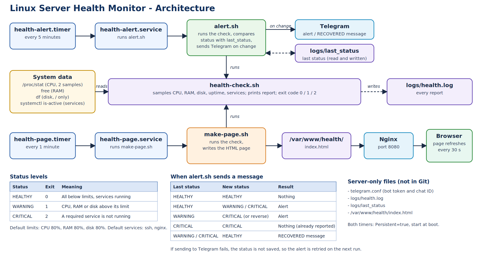

# Linux Server Health Monitor



A small, dependency-free Bash monitoring project for Ubuntu servers. It checks CPU, RAM, swap, load, disk, inodes, failed SSH logins, services, websites and MariaDB, sends a Telegram alert when the status changes, and shows live status and 24-hour history charts on a web page served by Nginx. Everything is scheduled with systemd timers and configured in one file.

Built as a beginner-friendly Linux administration project: one server, a few shell scripts, and standard tools (`/proc`, `free`, `df`, `journalctl`, `curl`, `systemctl`, systemd timers, Nginx).

## Features

- Reports CPU, RAM, swap, load average, uptime and disk usage
- Checks every mounted filesystem for disk and inode usage (tmpfs, snap and overlay mounts are skipped)
- Counts failed SSH logins in a time window
- Checks that required services (SSH and Nginx by default) are running
- Checks that websites answer with an HTTP success code
- Checks that MariaDB is running and answering a ping
- Gives an overall status: HEALTHY, WARNING or CRITICAL, plus exit codes (0, 1, 2) for other tools
- Sends a Telegram message only when the status changes, and a RECOVERED message when it returns to HEALTHY (no repeated alerts)
- Generates a color-coded HTML status page with CPU, RAM and disk charts for the last 24 hours
- Runs automatically through systemd timers, starts at boot, and logs every report
- All limits, services and websites live in one config file, so the scripts never need editing

## How it works

```
   health-alert.timer              health-page.timer
     (every 5 min)                    (every 1 min)
          |                                |
 health-alert.service            health-page.service
          |                                |
      alert.sh                        make-page.sh
  (RECORD_HISTORY=1)                       |
          \                              /
           health-check.sh  (collects the data, prints the report)
                 ^
        reads health-monitor.conf
                 |
   /proc, free, df, journalctl, systemctl, curl, mariadb-admin
          /                          \
 Telegram (only on status change)   /var/www/health/index.html
          |                                |
   logs/history.csv  --charts-->    Nginx :8080  -->  browser
```

1. `health-check.sh` reads `health-monitor.conf`, collects all metrics and prints a report. It samples `/proc/stat` twice, 1 second apart, to calculate CPU usage.
2. `alert.sh` runs the check, compares the new status with the last one stored in `logs/last_status`, and sends a Telegram message only if the status changed. It also saves one row to `logs/history.csv`.
3. `make-page.sh` runs the check and writes the result, plus three SVG charts drawn from `history.csv`, into an HTML page.
4. Two systemd timers start these jobs on a schedule.

### When an alert is sent

| Last status | New status | Result |
|---|---|---|
| HEALTHY | HEALTHY | Nothing |
| HEALTHY | WARNING or CRITICAL | Alert |
| WARNING | CRITICAL (or the reverse) | Alert (status changed) |
| CRITICAL | CRITICAL | Nothing (already reported) |
| WARNING or CRITICAL | HEALTHY | RECOVERED message |

If sending to Telegram fails, the new status is not saved, so the alert is retried on the next run.

## Status levels

| Status | Exit code | Triggered by |
|---|---|---|
| HEALTHY | 0 | Nothing is wrong |
| WARNING | 1 | CPU, RAM, swap, load average, any filesystem's disk or inode usage, or failed SSH logins above their limits |
| CRITICAL | 2 | A required service is not running, a website does not answer with HTTP 200-399, or MariaDB is down or not answering |

## Project structure

```
health-monitor/
├── health-check.sh          # collects metrics, prints the report, sets the exit code
├── alert.sh                 # runs the check, sends Telegram on status change, records history
├── make-page.sh             # runs the check, writes the HTML page with charts
├── health-monitor.conf      # limits, services, websites, MariaDB and history settings
├── telegram.conf.example    # template for the Telegram credentials (safe to share)
├── systemd/
│   ├── health-alert.service # what to run: alert.sh
│   ├── health-alert.timer   # when: every 5 minutes
│   ├── health-page.service  # what to run: make-page.sh
│   └── health-page.timer    # when: every minute
├── nginx/
│   └── health.conf          # Nginx server block that serves the page
├── .gitignore               # keeps telegram.conf and logs out of Git
└── README.md
```

Files that exist only on the server (not in the repository):

```
health-monitor/telegram.conf      # real bot token and chat ID (ignored by Git)
health-monitor/logs/health.log    # every report (ignored by Git)
health-monitor/logs/last_status   # last status, used to detect changes (ignored by Git)
health-monitor/logs/history.csv   # one row per 5 minutes for the charts (ignored by Git)
/var/www/health/index.html        # the generated status page
```

## Requirements

- Ubuntu (or another systemd-based Linux)
- Bash, `curl`, Nginx and the OpenSSH server (the default monitored services)
- MariaDB (only if `MARIADB_CHECK=yes`)
- A Telegram bot (only for alerts)
- To count failed SSH logins, the user running the monitor must be in the `adm` or `systemd-journal` group, otherwise that line shows `n/a`

```bash
# Run in terminal
sudo apt update                                    # refresh the package list
sudo apt install -y nginx openssh-server curl git # install the required packages
```

## Setup

### 1. Get the project

```bash
# Run in terminal
git clone git@github.com:julkarShabab/linux-health-monitor.git ~/health-monitor   # download the project
cd ~/health-monitor
mkdir -p logs                 # logs/ is not in the repository, so create it
chmod +x *.sh                 # allow the scripts to run
```

### 2. Edit the config

```bash
# Run in terminal
nano health-monitor.conf      # set your limits, website URLs and MariaDB options
```

Find the ports of your own sites with:

```bash
# Run in terminal
sudo grep -RHn "listen\|server_name" /etc/nginx/sites-enabled/   # lists the ports and names Nginx serves
```

### 3. Test the core check

```bash
# Run in terminal
./health-check.sh             # prints the report; the last line is the overall status
echo $?                       # prints the exit code (0 = healthy)
```

### 4. Set up Telegram alerts

1. In Telegram, message `@BotFather`, send `/newbot` and follow the prompts to get a bot token.
2. Send any message to your new bot.
3. Find your chat ID:

```bash
# Run in terminal
curl -s "https://api.telegram.org/botYOUR_TOKEN/getUpdates"   # find "chat":{"id":NUMBER in the output
```

4. Create the credentials file:

```bash
# Run in terminal
cp telegram.conf.example telegram.conf   # copy the template
nano telegram.conf                       # fill in BOT_TOKEN and CHAT_ID
chmod 600 telegram.conf                  # only your user can read the file
```

5. Test the alert flow by stopping Nginx, then starting it again:

```bash
# Run in terminal
sudo systemctl stop nginx
./alert.sh | tail -n 3      # one CRITICAL message arrives in Telegram
./alert.sh | tail -n 3      # no new message (already reported)
sudo systemctl start nginx
./alert.sh | tail -n 3      # a RECOVERED message arrives
```

### 5. Set up the web page

```bash
# Run in terminal
sudo mkdir -p /var/www/health            # folder Nginx will serve
sudo chown $USER:$USER /var/www/health   # let your user write the page
./make-page.sh                           # build the page once
sudo cp nginx/health.conf /etc/nginx/sites-available/health          # install the Nginx config
sudo ln -s /etc/nginx/sites-available/health /etc/nginx/sites-enabled/health   # enable it
sudo nginx -t                            # test the config
sudo systemctl reload nginx              # apply it
curl -I http://localhost:8080            # should return HTTP/1.1 200 OK
```

Open `http://YOUR_SERVER_IP:8080` in a browser. If another program already uses port 8080 (for example Apache), change the `listen` line in the Nginx config to a free port. The charts fill in over time, because one history row is added every 5 minutes.

### 6. Schedule with systemd timers

The unit files in `systemd/` use the user `shabab` and the path `/home/shabab/health-monitor`. Change both to match your system before installing them.

```bash
# Run in terminal
nano systemd/health-alert.service        # set User= and the paths to your username and folder
nano systemd/health-page.service         # same here
sudo cp systemd/*.service systemd/*.timer /etc/systemd/system/   # install the four unit files
sudo systemd-analyze verify /etc/systemd/system/health-*.service /etc/systemd/system/health-*.timer   # checks for mistakes; warnings about other system units are normal
sudo systemctl daemon-reload                                       # make systemd re-read its files
sudo systemctl enable --now health-alert.timer health-page.timer   # start at boot and start now
systemctl list-timers 'health-*' --all                             # both timers should show a NEXT time
```

Rules for systemd unit files:

- Comments must be on their own line. A `#` after a value on the same line is read as part of the value and breaks the unit (for example `Failed to enable unit: Invalid unit name #`).
- The services use `SuccessExitStatus=1 2`, so WARNING and CRITICAL are not treated as service failures.

## Configuration

All settings are in `health-monitor.conf`. It is plain Bash and contains no secrets.

| Setting | Default | Meaning |
|---|---|---|
| `CPU_WARN` | 80 | CPU usage warning limit (%) |
| `RAM_WARN` | 80 | RAM usage warning limit (%) |
| `DISK_WARN` | 80 | Disk usage warning limit (%), applied to every mounted filesystem |
| `INODE_WARN` | 80 | Inode usage warning limit (%) |
| `SWAP_WARN` | 50 | Swap usage warning limit (%) |
| `LOAD_WARN_PER_CORE` | 2 | Warn if the 1-minute load average is above (CPU cores x this number) |
| `SSH_FAIL_WARN` | 20 | Warn if failed SSH logins in the window are above this |
| `SSH_FAIL_WINDOW` | 1 hour ago | How far back to count failed SSH logins |
| `SERVICES` | ssh, nginx | Services that must be running |
| `WEBSITES` | health page | URLs that must answer with HTTP 200-399 |
| `WEB_TIMEOUT` | 5 | Seconds to wait for each website |
| `MARIADB_CHECK` | yes | Check MariaDB (service and ping) |
| `MARIADB_SERVICE` | mariadb | systemd name of the MariaDB service |
| `MARIADB_PING` | yes | Also run `mariadb-admin ping` (set to `no` if the ping always fails) |
| `HISTORY_FILE` | `logs/history.csv` | CSV the charts are drawn from |
| `HISTORY_MAX_LINES` | 2016 | Rows kept (about 7 days at one row per 5 minutes) |

Do not add `mariadb` to `SERVICES` when `MARIADB_CHECK=yes`, because it would be checked twice.

Limits can also be changed for a single run:

```bash
# Run in terminal
DISK_WARN=10 ./health-check.sh                   # test the warning logic without filling the disk
HEALTH_CONFIG=/tmp/test.conf ./health-check.sh   # use a different config file (useful for tests)
```

Changes to the config or scripts take effect on the next scheduled run. No commit or push is needed on the server.

## Example output

```
Server Health Report
====================

Date:     2026-10-11 11:10:02
Hostname: test01

CPU Usage:       1%
RAM Usage:       36%
Swap Usage:      n/a (no swap)
Load average:    0.05 0.03 0.01 (4 cores)
Disk Usage:      61%
Uptime:          27 minutes
SSH failures:    2 (1 hour ago)

Filesystems:
  /                      disk  61%   inodes 8%
  /boot                  disk  21%   inodes 1%

ssh service:     UP
nginx service:   UP
mariadb service: UP
MariaDB ping:    alive

Website http://localhost:8080: UP (HTTP 200)

Overall Status:  HEALTHY
```

When something is wrong:

```
nginx service:   DOWN

Overall Status:  CRITICAL
CRITICAL: nginx is not running!
```

Telegram messages look like this:

```
CRITICAL on test01: status changed from HEALTHY to CRITICAL
...report...

RECOVERED on test01: status is now HEALTHY (was CRITICAL)
...report...
```

## Monitoring with it

| Where | What it shows | How to look |
|---|---|---|
| Telegram | Status changes (alert and RECOVERED) | Nothing to do, messages arrive by themselves |
| Web page | Current status and 24-hour charts | Open `http://YOUR_SERVER_IP:8080` |
| Log | History of every report | `tail -n 20 logs/health.log` |
| systemd | Whether the monitor itself is running | `systemctl list-timers 'health-*' --all` |

```bash
# Run in terminal
tail -n 20 logs/health.log                      # latest reports
grep -E "CRITICAL|WARNING" logs/health.log      # problems only
grep "Alert sent" logs/health.log               # every status change
cat logs/last_status                            # the status the monitor last remembered
tail -n 5 logs/history.csv                      # latest rows used by the charts
systemctl list-timers 'health-*' --all          # last and next run of each timer
systemctl status health-alert.service --no-pager   # result of the last run
journalctl -u health-alert.service --since "1 hour ago" --no-pager   # what the job printed
./health-check.sh                               # one manual report (sends nothing, records nothing)
sudo systemctl start health-alert.service       # a full run with alerting, like a timer tick
```

## Starting at boot

`systemctl enable` makes both timers start at every boot, and `Persistent=true` runs a check that was missed while the server was off.

```bash
# Run in terminal
systemctl is-enabled health-alert.timer health-page.timer   # should print: enabled (twice)
systemctl is-enabled nginx ssh                              # the monitored services should be enabled too
```

## Testing the monitor

Break the server on purpose and check that the monitor notices:

```bash
# Run in terminal
sudo systemctl stop nginx                                 # expect CRITICAL
./health-check.sh
sudo systemctl start nginx                                # fix it

for i in $(seq "$(nproc)"); do yes > /dev/null & done     # load every CPU core
./health-check.sh                                         # expect a CPU WARNING
pkill yes                                                 # stop the load

DISK_WARN=10 ./health-check.sh                            # simulate a disk warning
LOAD_WARN_PER_CORE=0 ./health-check.sh                    # simulate a load warning
SSH_FAIL_WARN=-1 ./health-check.sh                        # simulate an SSH failures warning (needs a number, not n/a)

cp health-monitor.conf /tmp/test.conf                     # test a website failure with a throwaway config
echo 'WEBSITES=("http://localhost:9")' >> /tmp/test.conf  # a port where nothing listens
HEALTH_CONFIG=/tmp/test.conf ./health-check.sh            # expect: Website DOWN and CRITICAL
rm /tmp/test.conf
```

Avoid stopping SSH while connected through SSH, because it can lock you out. Stopping MariaDB briefly takes any apps that use it offline.

## Troubleshooting

| Problem | Likely cause | Fix |
|---|---|---|
| `Failed to enable unit: Invalid unit name #` | A comment sits on the same line as a value in a unit file | Move every comment to its own line, then run `daemon-reload` |
| Timer does not fire | Timer not enabled or not started | `sudo systemctl enable --now health-alert.timer`, then check `list-timers` |
| Service shows `failed` with `status=203/EXEC` | Wrong script path or the script is not executable | Check `ExecStart=` and run `chmod +x *.sh` |
| `health.log` stays empty | Wrong path or user in the service file | Check `journalctl -u health-alert.service` |
| No Telegram message | Status did not change, or `telegram.conf` is wrong | Check `cat logs/last_status` and test the token with `getMe` |
| Telegram message sent on every run | `logs/last_status` cannot be written | Check that `logs/` exists and belongs to your user |
| Telegram API returns `404 Not Found` | The URL is missing `bot` before the token | Use `https://api.telegram.org/bot<TOKEN>/...` |
| `getUpdates` returns an empty list | You have not sent a message to the bot yet | Send the bot a message and run it again |
| Inodes show `n/a` | The filesystem has no fixed inode table (for example btrfs), so there is nothing to measure | Normal, no fix needed. Check with `findmnt -no FSTYPE /` |
| SSH failures show `n/a` | The user is not in the `adm` or `systemd-journal` group | `sudo usermod -aG adm YOUR_USER`, then log in again |
| `MariaDB ping: NO ANSWER` but MariaDB works | The ping command returns a non-zero exit code on your setup | Test `mariadb-admin ping; echo $?`; if it is not 0, set `MARIADB_PING=no` |
| A website shows DOWN | Wrong URL or port, or the site returns a 4xx/5xx error | Test with `curl -I URL`; fix the URL in `WEBSITES` |
| Web page returns 404 from `Apache` | Apache is using port 8080 | Stop and disable Apache, or change the `listen` port |
| Page works, then breaks after a reboot | Apache is enabled and takes port 8080 first | `sudo systemctl disable apache2` |
| Charts say "not enough history yet" | Fewer than 2 rows in `history.csv` | Wait 5-10 minutes, or run `sudo systemctl start health-alert.service` twice |
| Everything runs twice | Old cron jobs are still active | `crontab -e` and remove the old lines |
| A service shows DOWN but is installed | Wrong service name | Check with `systemctl list-units --type=service` |

## Security notes

- `telegram.conf` holds your bot token. It is listed in `.gitignore`, so it is never committed. Keep its permissions at `600`.
- If a token is ever exposed (pasted publicly, committed), revoke it with `/revoke` in `@BotFather` and use the new one.
- `health-monitor.conf` is committed to Git. Do not put secrets in it, and check that the website URLs do not reveal anything private.
- The status page shows the hostname, server load and the websites you monitor. Keep it on your local network and do not expose it to the internet without authentication.

## Limitations

- Monitors a single machine
- Charts show only CPU, RAM and root-disk usage for the last 24 hours, drawn as simple SVG lines
- Total CPU and RAM only, with no per-process view
- A website counts as UP for any HTTP code from 200 to 399
- The log file `health.log` grows without limit (no log rotation yet)
- A shell-script learning project, not a replacement for Prometheus and Grafana

## Possible improvements

- Log rotation for `health.log`
- Password protection for the status page
- A one-command `install.sh` and ShellCheck in the workflow
- Alerts for individual problems, not only the overall status
- Move to Prometheus, Node Exporter and Grafana for multi-server monitoring

## What this project covers

Linux administration, Bash scripting, `systemctl` and services, systemd services and timers, processes and `/proc`, disk, inode, swap and load monitoring, reading logs with `journalctl`, HTTP checks with `curl`, Nginx configuration, Telegram Bot API calls, secrets handling with `.gitignore`, config files, and Git/GitHub basics.
